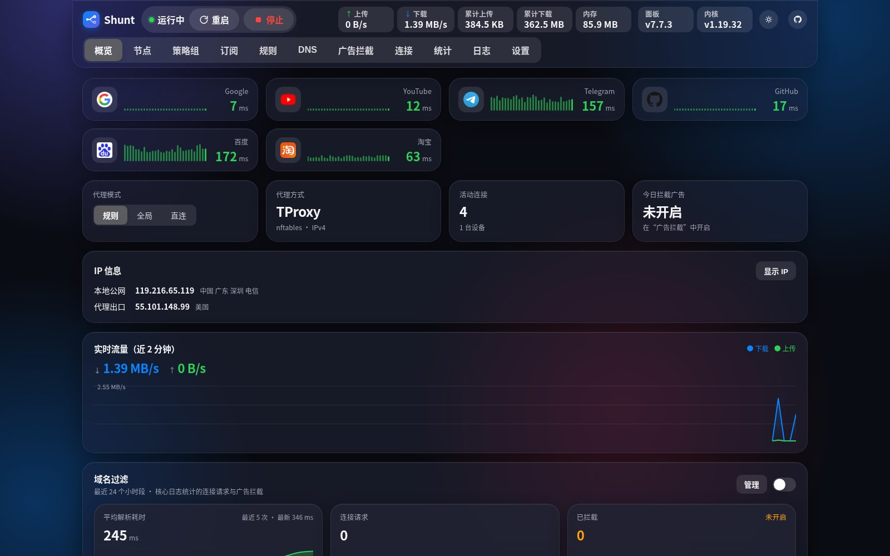
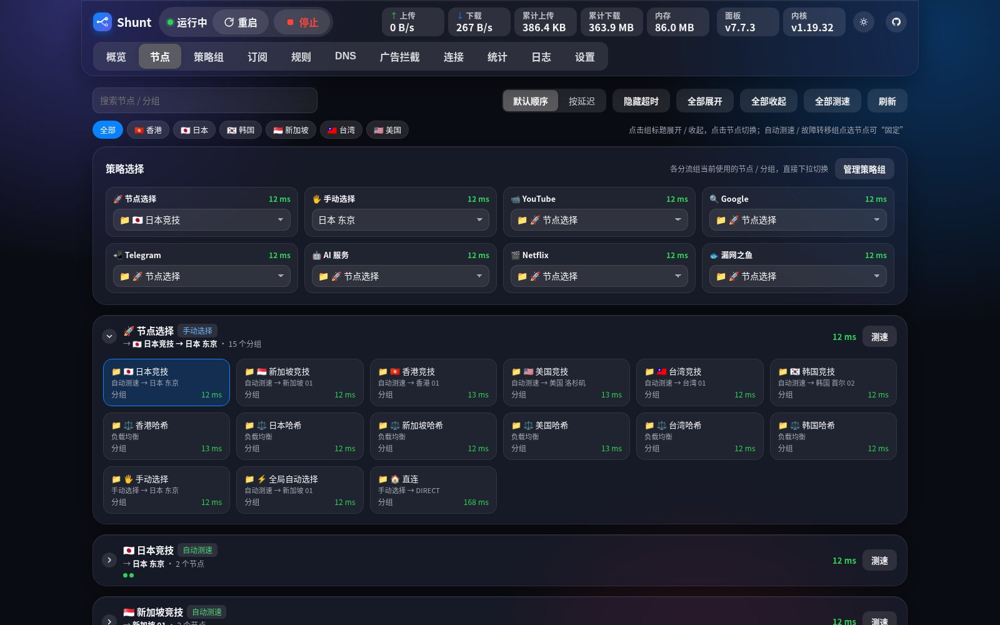
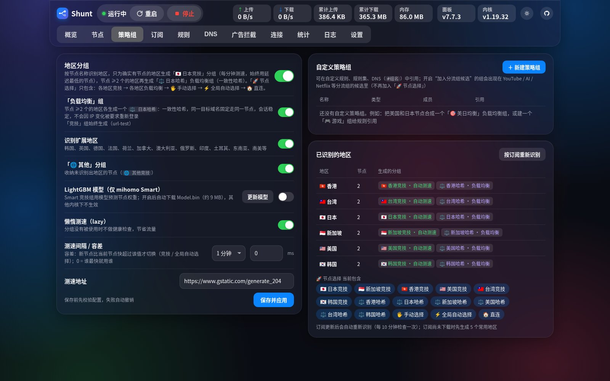
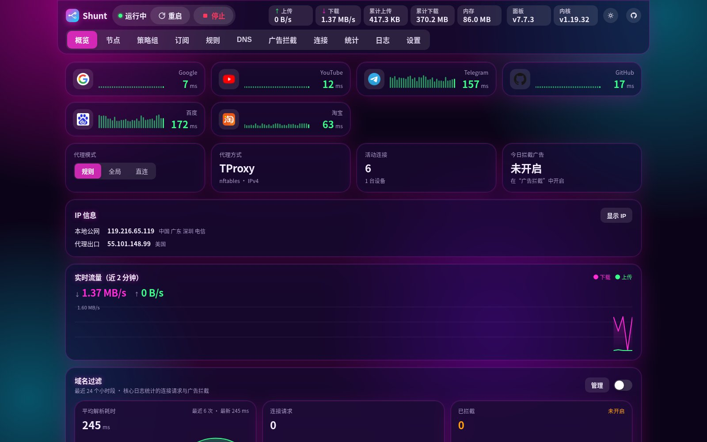

<p align="center"></p>

<h1 align="center">Shunt 分流</h1>

<p align="center">Alpine 旁路由一键透明代理 + Web 管理面板，支持 mihomo / sing-box 双内核</p>



本项目属于自娱自乐，更新随缘

## 能做什么

- **一键装好**：一条命令装完核心、面板和开机自启，也有不联网的离线安装包
- **透明代理**：局域网设备把网关和 DNS 指向旁路由就能用，支持 TProxy / TUN、Fake-IP、IPv6
- **订阅和节点**：粘贴订阅链接或节点链接即可，按地区自动分组；每个地区有「竞技」（自动选最快）和「哈希」负载均衡组
- **分流**：国内直连，国外走代理；YouTube、Google、Telegram、AI、Netflix 可单独选节点，支持自定义规则和策略组
- **三内核**：mihomo、mihomo Smart、sing-box 一键切换，共用同一份设置
- **概览一眼看清**：各站点延迟柱状图、实时流量、IP 信息（本地公网 / 代理出口和归属地，可一键隐藏）、域名过滤统计，顶栏显示面板和内核版本、有更新会提示
- **好用的面板**：连接、日志、统计、广告拦截（内置分类规则）、DNS 防泄露；设置 → 网络里有流媒体 / AI 解锁检测和网络诊断
- **省心**：核心无响应自动重启，修不好就自动切直连保证家里能上网；面板和内核都能在线更新、一键回滚
- **10 套主题 + 自定义背景图**（可每天自动换），手机上也好用

## 安装

在 Alpine Linux 上用 root 执行：

```sh
# 国内网络
wget -qO- https://ghfast.top/https://raw.githubusercontent.com/Skycnhe/Shunt/Hk001/install.sh | sh -s -- --cn

# 国外网络
wget -qO- https://raw.githubusercontent.com/Skycnhe/Shunt/Hk001/install.sh | sh
```

装完会显示面板地址（默认 `http://旁路由IP:8080`）。面板不需要密码，默认只允许局域网访问；要用域名（DDNS / 反向代理）访问，先在路由器上执行 `python3 /opt/mihomo-panel/server.py --allow-host 你的域名`，确需外网直连时执行 `--allow-public on`。脚本调用改动类接口需加请求头 `X-Shunt: 1`。

### 离线安装包

[Releases · offline](https://github.com/Skycnhe/Shunt/releases/tag/offline) 里有打包好的离线安装包：面板 + mihomo / mihomo Smart / sing-box 三个内核 + geo 数据 + sing-box 规则集 + 全部 apk 依赖，装的时候不用联网。每次面板更新和每周一自动重新打包，内核始终是最新版。

```sh
# 一键：自动选对应架构和 Alpine 版本的包，下载后安装
wget -qO- https://ghfast.top/https://raw.githubusercontent.com/Skycnhe/Shunt/Hk001/offline.sh | sh -s -- --cn   # 国内
wget -qO- https://raw.githubusercontent.com/Skycnhe/Shunt/Hk001/offline.sh | sh                                  # 国外

# 设备不联网：在电脑上下载 shunt-offline-<aarch64|x86_64>-alpine<3.22|3.23|3.24>.tar.gz，传到设备后
tar xzf shunt-offline-aarch64-alpine3.24.tar.gz && sh shunt-offline/install.sh
```

架构看 `uname -m`，Alpine 版本看 `cat /etc/alpine-release`。已安装的设备加 `--update-core` 可以用包里的内核和 geo 数据覆盖升级（旧内核留作 .bak，面板里可回滚）。

## 使用

1. 打开面板 →「订阅」粘贴你的订阅链接
2. 把要上网的设备（或主路由的 DHCP）的 **网关** 和 **DNS** 都改成旁路由的 IP
3. 回到「概览」看各站点延迟变绿就好了

## 截图

**节点**：按地区分组，点一下就能切换



**策略组**：地区分组、负载均衡、自定义分组



**外观**：10 套主题，可换背景图（图中为「赛博朋克」）



**手机**

<p align="center"></p>

## 常用命令

```sh
rc-service shunt-core restart      # 重启核心
rc-service shunt restart           # 重启面板
/opt/mihomo-panel/tproxy.sh stop   # 临时关闭透明代理（apply 恢复）
```

面板和内核都能在「设置」里在线更新，出问题可一键回滚。

## 常见问题

- **日志页偶尔出现「内核未运行或正在重启」**：sing-box 不支持热重载，保存规则、订阅、DNS、策略组等设置或自动更新订阅时会重新加载，控制端口会断开几秒，恢复后自动重连。mihomo 是热重载，没有这个现象
- **在线更新失败**：面板会列出镜像、代理、直连各条线路的错误；都不通时可重新执行上面的安装命令覆盖更新，设置会保留
- **截图时不想暴露 IP**：点概览「IP 信息」卡片的「隐藏 IP」


## 端口

8080 面板 · 7890 HTTP/SOCKS 代理 · 7893 TProxy · 1053 DNS · 9090 控制器（仅本机）

## 开发

- 后端源码在 `shunt/`（Python 包），前端源码在 `web/`；设备上部署的单文件 `server.py`、`index.html` 由 `python3 tools/build.py` 生成，改完源码后一起提交
- 测试：`python3 -m unittest discover -s tests -t .`（单元测试）、`sh selftest.sh`（端到端，需要内核二进制）
- 详细说明见 [shunt/README.md](shunt/README.md)
- 当前版本见 [CHANGELOG.md](CHANGELOG.md)

## 特别鸣谢

- [MetaCubeX/mihomo](https://github.com/MetaCubeX/mihomo)：代理核心
- [SagerNet/sing-box](https://github.com/SagerNet/sing-box)：代理核心
- [MetaCubeX/meta-rules-dat](https://github.com/MetaCubeX/meta-rules-dat)：GeoIP / GeoSite 数据与规则集
- [AdGuard DNS filter](https://github.com/AdguardTeam/AdGuardSDNSFilter)、[anti-AD](https://github.com/privacy-protection-tools/anti-AD)：广告拦截规则
- [ghfast.top](https://ghfast.top/)：国内 GitHub 下载加速
- [Alpine Linux](https://alpinelinux.org/)：运行系统

---

更新记录和详细说明见 [CHANGELOG.md](CHANGELOG.md)。
